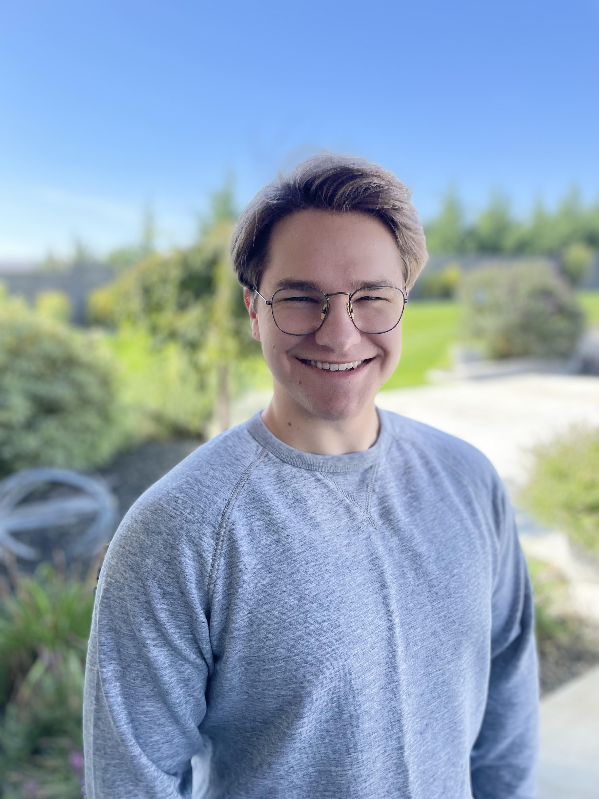

#Brenden Clapp

Hello, my name is Brenden Clapp. I'm currently a senior at Washington State University studying Mechanical Engineering and Applied Mathematics
I'm particularly interested in computational fluid dynamics, numerical methods, and medical modeling. I've taken the liberty of creating this space
as a means to share my projects.

## Projects 

- [Computational Fluid Dynamics](cfd.html)
- Custom Alarm Clock
- Potato AI Vision
- Dual-Eye2Heart Research

